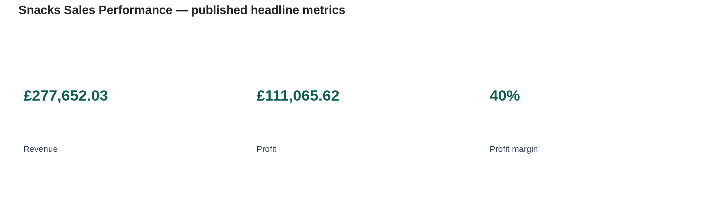
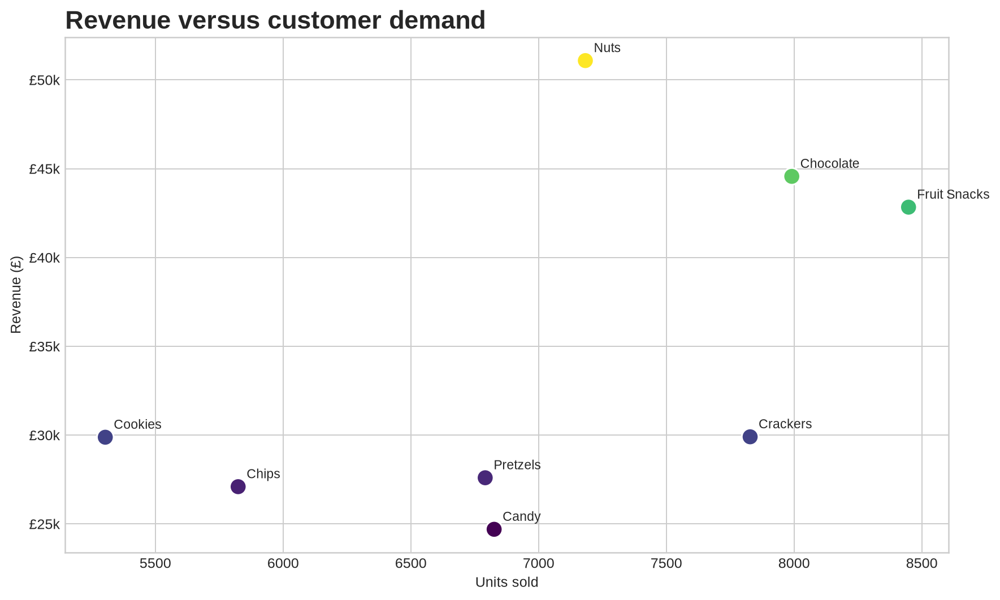
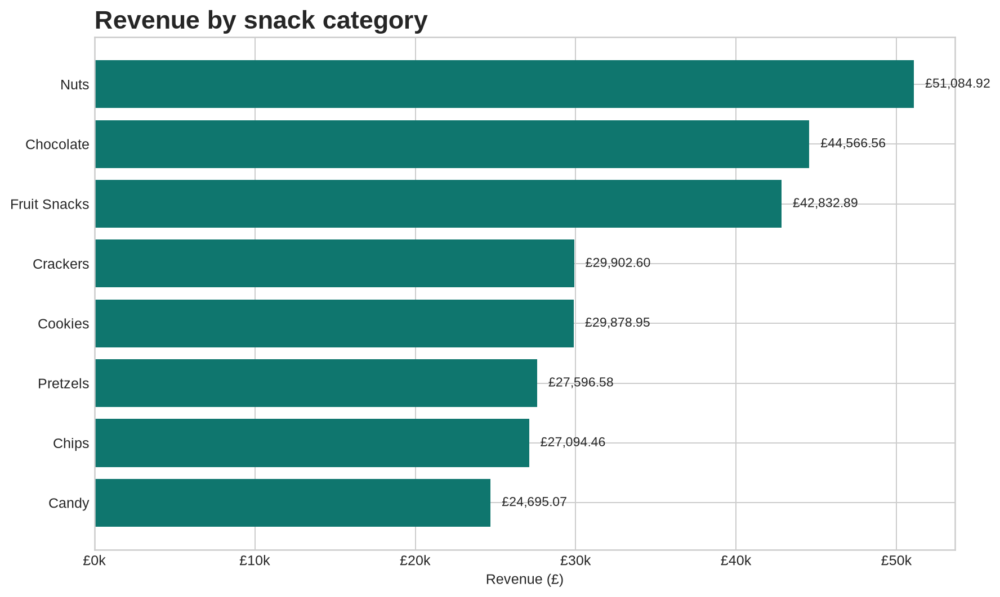

# Snacks Sales Performance Dashboard

A professional, reproducible companion repository for Christian Iyayi's Power BI case study, **“Beyond £2.3 Million in Sales: Uncovering the Real Profit Story.”** The project examines how a snack business can use sales data to understand revenue, profitability, demand, categories, brands, regions, and customer trends.

> **Source report:** [Beyond £2.3 Million in Sales: Uncovering the Real Profit Story](https://medium.com/@krisnice2002gmail.com/beyond-2-3-million-in-sales-uncovering-the-real-profit-story-7bc34c3338dc)

## Published headline metrics

| Metric | Value |
|---|---:|
| Sales records | 200 |
| Units sold | 56,195 |
| Revenue | £277,652.03 |
| Profit | £111,065.62 |
| Profit margin | 40% |
| Average selling price | £4.94 per unit |
| Product categories | 8 |
| Brands | 10 |
| Regions | 5 |

## Key findings

- **Nuts** generated the highest category revenue at **£51,084.92** from **7,183 units**.
- **Fruit Snacks** led customer demand with **8,448 units sold**, while generating **£42,832.89** in revenue.
- **Chocolate** generated **£44,566.56** from **7,991 units**.
- Nuts, Chocolate, and Fruit Snacks together contributed approximately **50% of total revenue**.
- Revenue should be evaluated alongside volume and margin: the highest-value category is not automatically the category with the strongest demand.

## Derived visual summary







## Repository contents

- [`docs/report.md`](docs/report.md) — faithful Markdown transcription of the accessible report content, with source attribution.
- [`data/category_performance.csv`](data/category_performance.csv) — category-level figures published in the article.
- [`src/analysis.py`](src/analysis.py) — small reproducible Python script for regenerating the charts.
- [`assets/`](assets/) — derived charts created from the article’s published figures.
- [`docs/power-bi-notes.md`](docs/power-bi-notes.md) — implementation notes for rebuilding the dashboard in Power BI.

## Reproduce the visuals

```bash
python3 -m pip install matplotlib pandas
python3 src/analysis.py
```

The script writes PNG files into `assets/` and does not require the underlying private Excel workbook.

## Scope and attribution

This repository is a companion to the linked Medium report, not a replacement for the original Power BI workbook. The article describes a 200-row source dataset and reports aggregate results, but it does not publish the underlying row-level data, the full brand/region tables, or the original Power BI file. The charts in this repository are therefore **derived visualizations** based only on the category figures publicly stated in the article.

The repository preserves the report’s claims and source link while avoiding invented brand, regional, monthly, or customer-level values.

## License

The analytical code and repository structure are released under the MIT License. The report text and article imagery remain the property of their original author and are referenced for attribution. See [`LICENSE`](LICENSE).
